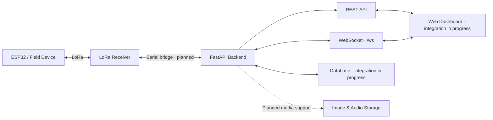

<h1 align="center">🛡️ SENTINEL-X</h1>

<h3 align="center">Real-Time Tactical Communication & Situational Awareness</h3>

<p align="center">
  Connecting field devices, backend services, and live dashboards in one communication platform.
</p>

<p align="center">
  
  
  
  
</p>

---

## 🚀 What is Sentinel-X?

**Sentinel-X** is a real-time communication and situational-awareness project designed to connect ESP32-based field devices, LoRa communication, a FastAPI backend, and a web dashboard.

The goal is to move field information from device to dashboard through a modular architecture—with support for messages, device information, alerts, and planned media capabilities such as images and audio.

> **Project vision:** Field device → communication link → backend API → real-time events → dashboard.

## ✨ Core Capabilities

- ⚡ **REST API:** HTTP endpoints for messages, devices, and alerts.
- 🔌 **WebSocket channel:** A real-time connection at `/ws` for supported event messages.
- 🚨 **Alert handling:** Create, retrieve, and resolve alerts through backend API routes.
- 📡 **Hardware integration path:** Designed to connect ESP32 and LoRa communication through a separate serial bridge.
- 🧪 **Automated tests:** Backend and WebSocket tests help catch regressions as the project evolves.
- 🧩 **Modular structure:** API routes, schemas, services, and WebSocket logic are separated into dedicated modules.

### 🛠️ Work in progress

- ESP32/LoRa serial communication bridge.
- Frontend integration with REST endpoints and WebSocket events.
- Database integration and persistence verification.
- Image and audio upload, storage, retrieval, and event notifications.
- Full end-to-end testing across hardware, backend, and frontend.

These items are planned or in progress; they should not be considered complete until implemented and tested.

## 🏗️ Architecture



### Intended data flow

1. A field device produces a message or event.
2. The receiver obtains data over the device communication link.
3. A serial bridge passes the data to the backend (integration in progress).
4. FastAPI exposes API operations and WebSocket events.
5. The dashboard consumes API responses and real-time events.
6. Planned media support will add controlled image/audio upload and retrieval.

## 🧰 Tech Stack

| Layer | Technology | Purpose |
|---|---|---|
| Backend API | Python, FastAPI | HTTP endpoints and application logic |
| Real-time communication | WebSockets | Live client connections and events |
| Data validation | Pydantic | Request and response models |
| ASGI server | Uvicorn | Run the FastAPI application |
| Hardware | ESP32 + LoRa | Field-device communication; integration in progress |
| Frontend | Team web client | Dashboard integration in progress |
| Testing | pytest, FastAPI TestClient | Automated backend/API checks |

## 📂 Project Structure

The repository may evolve as the team integrates the remaining components. The main code areas include:

```text
SENTINEL-X/
├── backend/
│   ├── app/
│   │   ├── api/
│   │   │   └── routes/
│   │   │       ├── alerts.py
│   │   │       ├── devices.py
│   │   │       └── messages.py
│   │   ├── schemas/
│   │   ├── services/
│   │   └── main.py
│   ├── tests/
│   └── requirements.txt
├── ws/
│   ├── manager.py
│   ├── events.py
│   └── tests/
├── .github/
│   └── workflows/
│       └── backend-tests.yml
└── README.md
```

*This is a guide to the main code areas, not an exhaustive file listing.*

## ⚙️ Getting Started

### Prerequisites

- Python 3.12 (recommended to match the current CI workflow)
- Git
- PowerShell, Command Prompt, or a Unix-like terminal

### 1. Clone the repository

```bash
git clone https://github.com/VenomStriker859/SENTINEL-X.git
cd SENTINEL-X
```

### 2. Create and activate a virtual environment

**Windows PowerShell**
```powershell
py -3.12 -m venv .venv
.\.venv\Scripts\Activate.ps1
```

**Linux / macOS**
```bash
python3.12 -m venv .venv
source .venv/bin/activate
```

### 3. Install dependencies

```bash
python -m pip install --upgrade pip
python -m pip install -r backend/requirements.txt
python -m pip install pytest httpx
```

### 4. Start the backend

Run this from the repository root:

```bash
python -m uvicorn app.main:app --app-dir backend --reload --host 127.0.0.1 --port 8000
```

When the server starts, open:

- **API base:** `http://127.0.0.1:8000`
- **Interactive API docs:** `http://127.0.0.1:8000/docs`
- **Alternative API docs:** `http://127.0.0.1:8000/redoc`
- **WebSocket:** `ws://127.0.0.1:8000/ws`

The `/docs` page shows the routes exposed by the running version of the application.

## 🔌 API Overview

The backend currently organizes HTTP routes around these areas:

| Area | Purpose |
|---|---|
| Health | Check whether the API is responding |
| Messages | Create and retrieve messages; handle duplicate-message responses |
| Devices | Access device-related API operations |
| Alerts | Create, retrieve, and resolve alerts |
| WebSocket | Maintain a real-time connection and exchange supported events |

For exact paths, request schemas, and response examples, use the running `/docs` page. Proposed image/audio endpoints should not be considered available until implemented and documented.

### WebSocket

Connect to:

```text
ws://127.0.0.1:8000/ws
```

The WebSocket package uses structured event messages, generally containing an event name, data, and a timestamp. Supported event names in the current implementation include `connected`, `pong`, `error`, `new_message`, and `alert`; the precise payload depends on the event.

**Testing note:** API-triggered broadcasts have tests using a mocked broadcast manager. Verify the complete live REST-to-WebSocket path during end-to-end testing.

## 🧪 Run Tests

From the repository root with the virtual environment activated:

**Windows PowerShell**
```powershell
$env:PYTHONPATH = "$PWD\backend;$PWD"
python -m pytest -vv backend\tests ws\tests
```

**Linux / macOS**
```bash
PYTHONPATH="backend:." python -m pytest -vv backend/tests ws/tests
```

The development test suite previously passed **27 tests**. Run the tests again or check the latest GitHub Actions run for current status, since results can change with new commits.

A GitHub Actions workflow runs backend tests on relevant pushes and pull requests to `tester/rough`.

## 🗺️ Roadmap

- [x] FastAPI application and core REST route groups
- [x] WebSocket connection and event manager
- [x] Automated backend and WebSocket tests
- [x] CI workflow for backend tests
- [ ] Complete database integration and verify persistence
- [ ] Complete ESP32/LoRa serial bridge
- [ ] Connect frontend to REST APIs and WebSocket events
- [ ] Implement image upload, storage, and retrieval
- [ ] Implement audio upload, storage, and retrieval
- [ ] Add media metadata and notifications
- [ ] Run full hardware-to-dashboard end-to-end tests
- [ ] Review authentication, authorization, and production deployment requirements

## 🤝 Contributing

Sentinel-X is being developed collaboratively. To keep changes easy to review:

1. Coordinate with the team before modifying shared components.
2. Create a separate branch for your work.
3. Keep changes focused and avoid duplicating existing API or WebSocket logic.
4. Add or update tests when behavior changes.
5. Run the test suite before opening a pull request.
6. Document new endpoints, event payloads, configuration, and setup steps.
7. Never commit credentials, `.env` files, private keys, virtual environments, or generated artifacts.

## 🔐 Security & Deployment

Sentinel-X is under active development and should **not be considered production-ready** without further review. Before deployment, evaluate authentication, authorization, input validation, rate limiting, secure media storage, logging, secrets management, and network transport security.

Do not expose a development server directly to the public internet.

## 👥 Project

Built collaboratively as a hardware-and-software integration project.

- **Repository:** [VenomStriker859/SENTINEL-X](https://github.com/VenomStriker859/SENTINEL-X)
- **Issues and contributions:** Use GitHub Issues and Pull Requests to coordinate work.

---

<p align="center">
  <strong>🛡️ SENTINEL-X</strong><br>
  Connecting devices. Delivering signals. Building situational awareness.
</p>

<p align="center">
  <em>Built with Python, FastAPI, WebSockets, ESP32, and LoRa.</em>
</p>
